# TapSplit — Improve It! (Splitwise)

> **Pay for what you ate. Not a rupee more.**
> A collaborative, item-by-item bill-splitting feature for Splitwise: one person pastes the receipt, shares a link, and everyone taps the dishes they had.

---

## 1. Product & Problem

**Product:** [Splitwise](https://www.splitwise.com), the most popular app for tracking shared expenses between friends, roommates and travel groups.

**The problem:** Splitwise is great at recording *that* money was spent, but the moment that causes the most friction, **splitting a restaurant bill fairly**, is still painful:

| Pain point | What happens today |
|---|---|
| **"Just split it equally"** | Friends who had a ₹40 chai end up paying the same as the one who ordered a ₹280 starter and two coffees. Splitting equally is easy, so people do it, and some of them quietly feel cheated. |
| **The payer does all the work** | Splitting by item means one person has to type every item and remember who ate what, at the table, while everyone waits. |
| **Tax, service charge and discounts are manual math** | GST, service charge and a coupon have to be shared out in proportion by hand. Nobody does this correctly. |
| **Shared dishes** | "We split the naan between two of us, and three of us shared the pizza" can't be expressed easily. |
| **Getting paid back** | After the split, the payer still has to chase each person and share their UPI ID. |

Students eat out in groups a lot, often on tight budgets, so this hits them hardest.

## 2. The Solution: TapSplit

TapSplit turns bill splitting from **one person doing data entry** into **everyone tapping their own items at the same time**.

**How it works**

1. **Snap or paste:** The payer **takes a photo or screenshot of the bill** (upload it, drag it in, or press Ctrl+V), or pastes the receipt text from an e-bill or SMS. The server reads the photo with OCR, and TapSplit's parser pulls out items, quantities, GST, service charge and discounts, ignoring headers like "Table 7" or "Bill No". Everything stays editable in case the OCR misreads something.
2. **Share:** TapSplit creates a short link and a **QR code**. Friends at the table scan it from the payer's phone, or the payer sends it to WhatsApp in one tap. **Friends don't need an account or the app.** They open the link and type their name.
3. **Tap:** Everyone taps the items they had. Claims update **live** on every phone, with colored avatars on each item. If several people tap the same item, it is split evenly between them automatically ("Split 3 ways · ₹120 each").
4. **Settle:** TapSplit shares out tax, tip and discount **in proportion to what each person ordered**, rounded to the paisa so the shares add up *exactly* to the bill. Each friend gets a **"Pay via UPI"** button pre-filled with the payer's UPI ID and the exact amount.

**Details that make it work in real life**

- **Progress bar, "unclaimed" warnings and an *Unclaimed* filter**, so nobody can leave until every item is claimed. Confetti 🎉 when the last item is claimed.
- **All / Mine / Unclaimed filters** make long bills easy to scan.
- **Tap your total** to see exactly how it was calculated: each dish, your share of tax and service, and your discount.
- **Payment tracking:** friends tap "I've paid" (or the payer taps "Mark as received"), so everyone can see who still owes.
- **Friends without a phone:** the payer can add them and tap items on their behalf ("Tapping as: Chen").
- **Lock bill:** once everyone has claimed, the payer locks the bill so the totals become final.
- **Payer-only controls:** editing tax/tip/discount, adding a forgotten item, and locking are protected by a secret admin token that only the creator's browser holds.

## 3. Visual Representation

### User flow

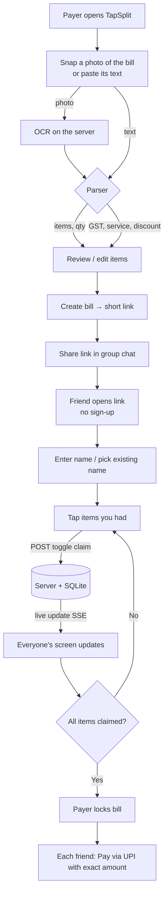

### Wireframe (mobile)

```
┌────────────────────────────┐   ┌────────────────────────────┐   ┌────────────────────────────┐
│ ⟂ TapSplit                 │   │ ⟂ TapSplit                 │   │ Who owes what              │
├────────────────────────────┤   ├────────────────────────────┤   │ ┌────────────────────────┐ │
│ Pay for what you ate.      │   │ Friday dinner     ₹1,429   │   │ │⚠ 1 item not claimed    │ │
│                            │   │ Paid by Aarav · ● live     │   │ └────────────────────────┘ │
│ What was it? [__________]  │   │ ██████████████░░  86%      │   │ Person Food Tax Disc Total │
│ Who paid?    [__________]  │   │ [Share link] [Who owes?]   │   │ (A)Aarav 550  55  -40  565 │
│ UPI ID       [__________]  │   ├────────────────────────────┤   │ (B)Bea   470  47  -34  483 │
│                            │   │ (A)Aarav (B)Bea (C)Chen    │   │ (C)Chen  370  37  -27  380 │
│ [Paste receipt|Type items] │   ├────────────────────────────┤   │                            │
│ ┌────────────────────────┐ │   │ ☐ Paneer Tikka   (A)  ₹280 │   │ Settle up                  │
│ │ Paneer Tikka 1x280     │ │   │ ☑ Butter Naan  (A)(B) ₹180 │   │ (B)Bea  → (A)Aarav  ₹483   │
│ │ Butter Naan  4x45 ...  │ │   │   Split 2 ways · ₹90 each  │   │ (C)Chen → (A)Aarav  ₹380   │
│ └────────────────────────┘ │   │ ☑ Dal Makhani    (B)  ₹260 │   │                            │
│ [Read items]               │   │ ☐ Cold Coffee (A)(C)  ₹360 │   │                            │
│ Item        Qty  Price     │   │ ☑ Masala Chai    (B)  ₹120 │   │                            │
│ Tax [__] Tip [__] Disc [__]│   ├────────────────────────────┤   ├────────────────────────────┤
│ [ Create & get link → ]    │   │ Your share  ₹483  [Pay UPI]│   │ Your share  ₹483  [Pay UPI]│
└────────────────────────────┘   └────────────────────────────┘   └────────────────────────────┘
      1. Create bill                  2. Tap your items (live)          3. Settle up
```

### Screenshots of the working prototype

| Scan a photo of the bill | Photo → editable items | Share via QR / WhatsApp | Friend joins via link |
|---|---|---|---|
| 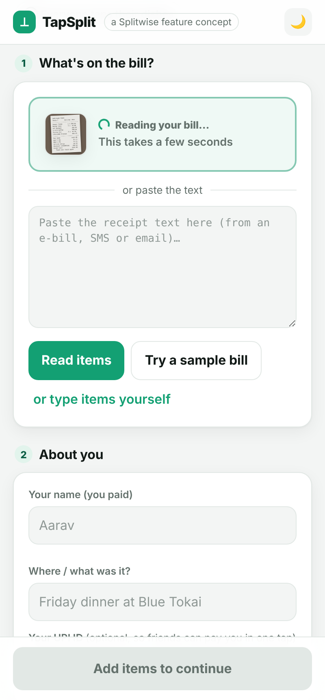 | 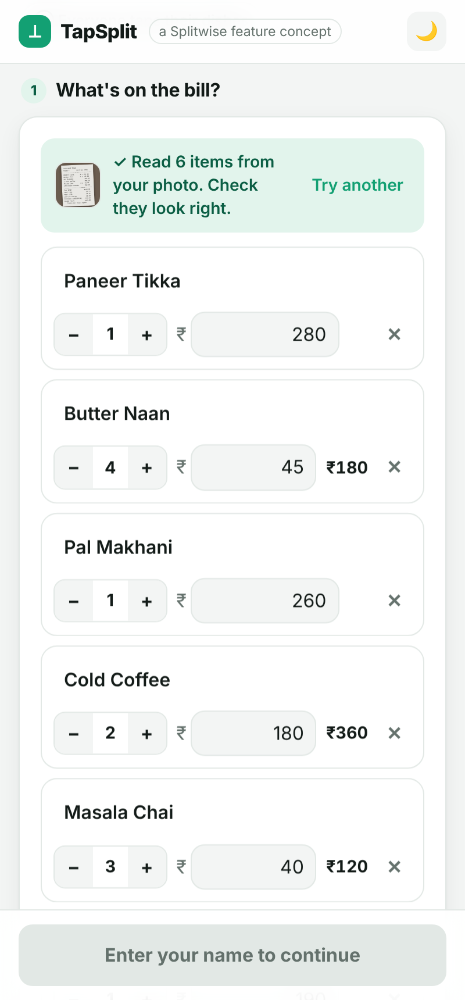 | 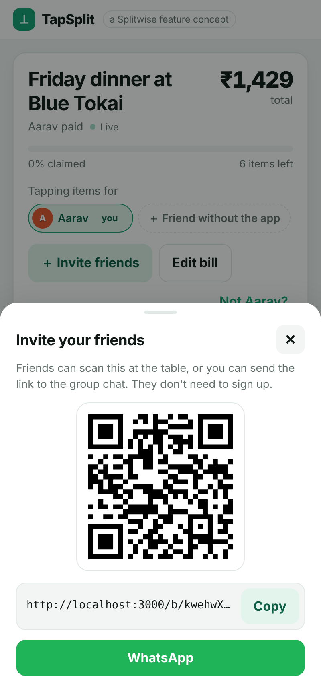 | 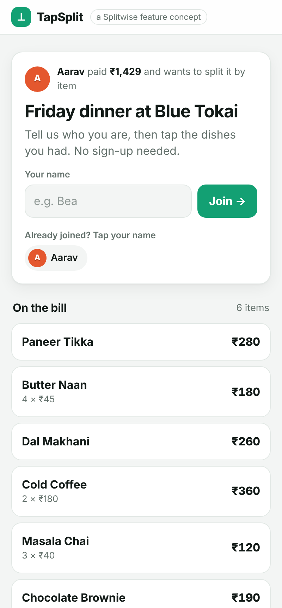 |

| Live claiming | Tapping for a friend | Your breakdown | Who owes what + paid status |
|---|---|---|---|
| 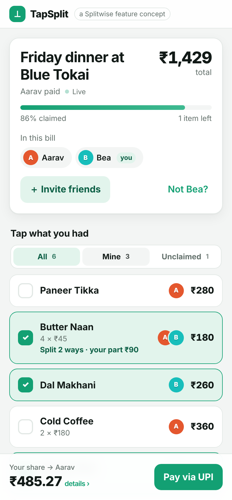 | 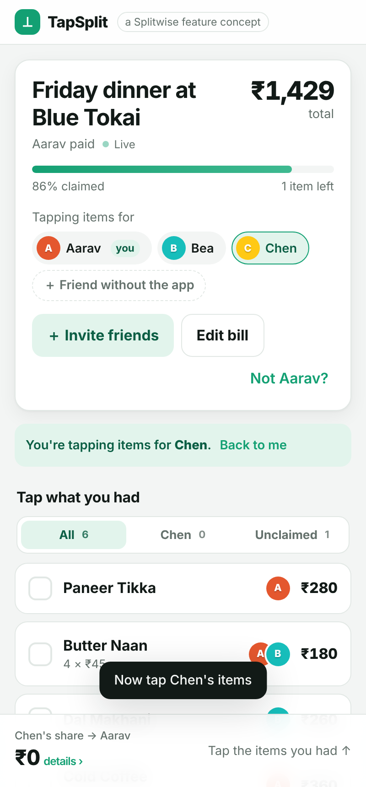 | 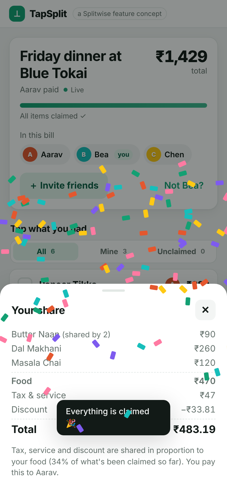 | 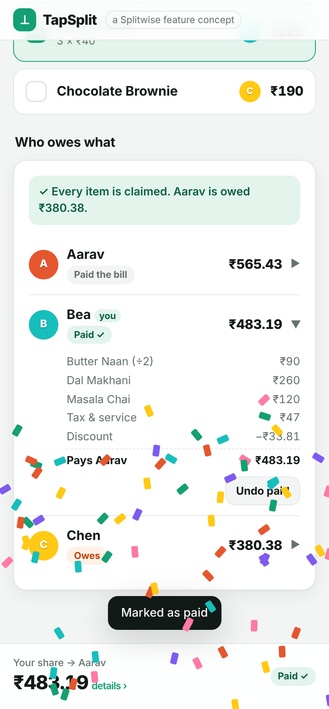 |

| Pasting receipt text instead | Dark mode (🌙 toggle) | | |
|---|---|---|---|
| 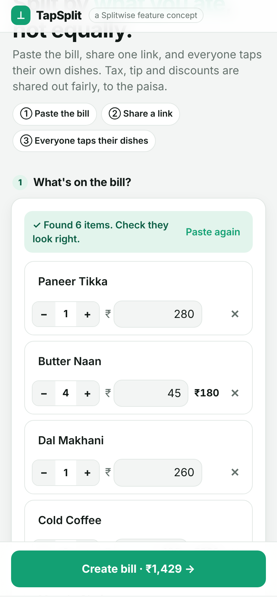 | 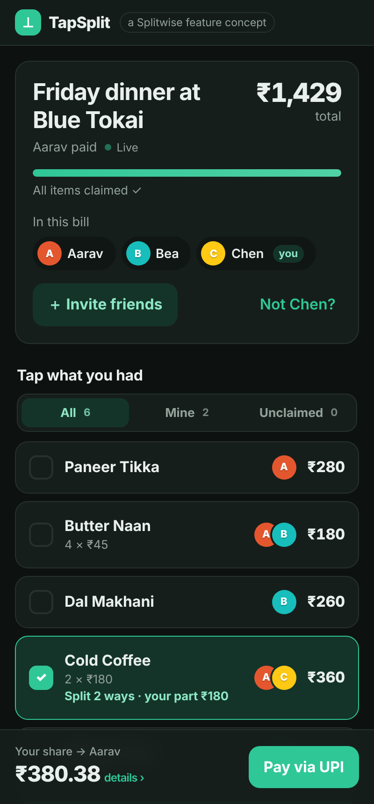 | | |

**Desktop:** items on the left, live summary on the right.

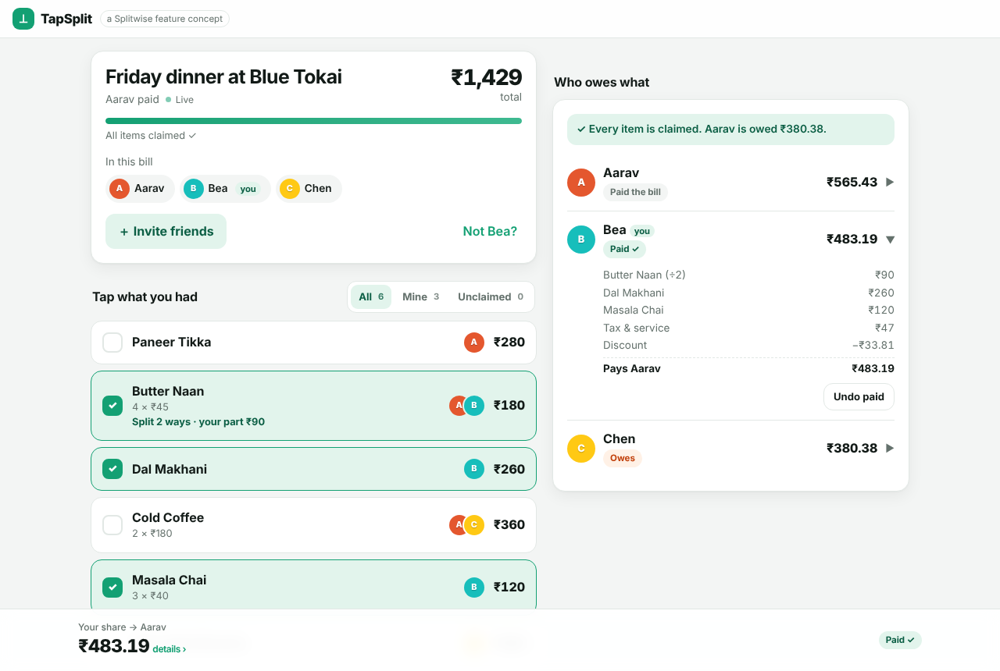

## 4. Implementation

### Architecture

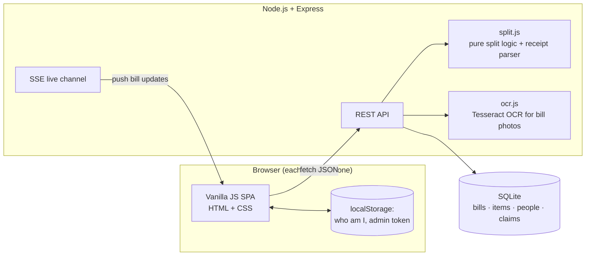

### Tech stack

| Layer | Choice | Why |
|---|---|---|
| Frontend | HTML, CSS, vanilla JavaScript (single-page app, History API routing) | No build step; loads fast on mobile; easy to read |
| Real-time | **Server-Sent Events (SSE)** | One-way "push the new bill state" is all we need; simpler than WebSockets and works through proxies |
| Backend | **Node.js + Express** | Small REST API, same language as the frontend |
| Database | **SQLite** (Node's built-in `node:sqlite`) | Zero setup, a single file, nothing native to compile; the tables carry over to PostgreSQL unchanged |
| Payments | **UPI deep links** (`upi://pay?pa=…&am=…`) | Opens GPay/PhonePe/Paytm with the amount pre-filled, and needs no payment gateway |
| Sharing | QR codes generated in the browser (`qrcode-generator`) + WhatsApp share links | Friends at the same table can join in seconds |
| OCR | **Tesseract** (`tesseract.js` + bundled English data from `@tesseract.js-data/eng`) | Reads photos and screenshots of bills on the server. Free, needs no API key, works offline |
| Tests | `node:test` (built-in) | Unit tests for the split math and parser, plus API integration tests (including OCR on a sample receipt photo) |

### Key design decisions

- **Money is stored in integer paise**, never floats. Shares are split with the *largest-remainder method*, so ₹100 split 3 ways becomes ₹33.34 + ₹33.33 + ₹33.33. Everyone's totals always add up to the bill exactly (there is a test for this).
- **Proportional extras:** tax, service charge and discount are distributed by each person's share of the food subtotal. Someone who ordered 40% of the food pays 40% of the GST and gets 40% of the discount.
- **No sign-up for friends, but still safe:** the bill ID is random and unguessable. Only the creator gets a secret `adminToken` (sent as the `x-admin-token` header) for edits and locking. Locked bills reject all changes with `409`.
- **Optimistic UI:** a tapped item highlights instantly, and the SSE stream then confirms the server's state on every phone.
- **Mobile-first UX:** thumb-friendly tap targets, a sticky bottom bar with your running total, bottom sheets instead of browser pop-ups, haptic feedback, a light/dark toggle, and respect for "reduce motion" settings.

### Data model

```
bills  (id, admin_token, title, upi_id, tax, tip, discount, payer_id, locked, created_at)
items  (id, bill_id → bills, name, price, qty)
people (id, bill_id → bills, name, color, paid)    UNIQUE(bill_id, name)
claims (item_id → items, person_id → people)        PRIMARY KEY(item_id, person_id)
```

### REST API

| Method | Endpoint | Purpose |
|---|---|---|
| `POST` | `/api/parse-receipt` | Receipt text → `{ items, tax, tip, discount }` |
| `POST` | `/api/scan-receipt` | Photo/screenshot (JPEG or PNG body) → OCR → same as above, plus the text it read |
| `POST` | `/api/bills` | Create bill → `{ id, adminToken, personId, bill }` |
| `GET` | `/api/bills/:id` | Bill + items + people + claims + computed split |
| `GET` | `/api/bills/:id/events` | **SSE stream** of live bill updates |
| `POST` | `/api/bills/:id/people` | Join the bill with a name |
| `POST` | `/api/bills/:id/claims/toggle` | Tap an item (claim / unclaim) |
| `POST` | `/api/bills/:id/people/:personId/paid` | Mark someone as paid / not paid |
| `PATCH` | `/api/bills/:id` | *(payer)* Edit tax/tip/discount/UPI, lock or unlock |
| `POST` | `/api/bills/:id/items` | *(payer)* Add a forgotten item |
| `DELETE` | `/api/bills/:id/items/:itemId` | *(payer)* Remove an item |

### How it would ship inside Splitwise

1. Add a **"Split by item"** button to Splitwise's "Add expense" screen, which opens this flow.
2. Move OCR **on-device** (Google ML Kit / Apple Vision): it's faster, works offline, and the photo never leaves the phone.
3. When the bill is locked, create normal **Splitwise expenses** for each person, so balances, reminders and "Settle up" keep working as they do today.
4. Scale-out: PostgreSQL instead of SQLite, and Redis pub/sub so live updates work across multiple server instances.

## 5. Working Prototype: Run it

Requires **Node.js 22.5+**.

```bash
npm install
npm start          # → http://localhost:3000
npm test           # run unit + API tests
```

**Try the demo:**
1. Open `http://localhost:3000` and click **Scan a photo or screenshot of the bill**. Pick `test/fixtures/receipt-photo.jpg` (or a photo of any real bill), or just click **Try a sample bill**. Type your name, then click **Create bill**.
2. Copy the link and open it in a **private/incognito window** (that's "your friend"). Join as a different name.
3. Tap items in both windows and watch them update live. Scroll down to **Who owes what**.

### Project structure

```
tapsplit/
├── server.js          # Express app: REST API + SSE live updates
├── db.js              # SQLite schema (node:sqlite)
├── split.js           # Pure logic: proportional split, rounding, receipt parser
├── ocr.js             # Reads bill photos/screenshots with Tesseract OCR
├── public/
│   ├── index.html
│   ├── styles.css     # Mobile-first, light by default with a dark-mode toggle
│   └── app.js         # Single-page frontend (bottom sheets, filters, QR share, live updates)
├── test/
│   ├── split.test.js  # Split math + parser tests
│   ├── api.test.js    # End-to-end API tests (incl. OCR)
│   └── fixtures/      # A sample receipt photo for the OCR test
└── docs/screenshots/
```

### Future ideas

- Smarter scanning for crumpled or handwritten bills (e.g. a vision AI model)
- "Usual order" memory: suggests items you usually claim at the same restaurant
- Group bills over a trip into one settle-up using the minimum number of transfers
- Nudges: auto-remind people who haven't claimed after 10 minutes
